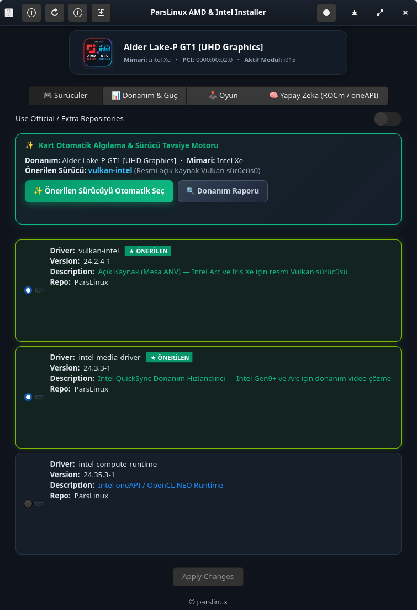
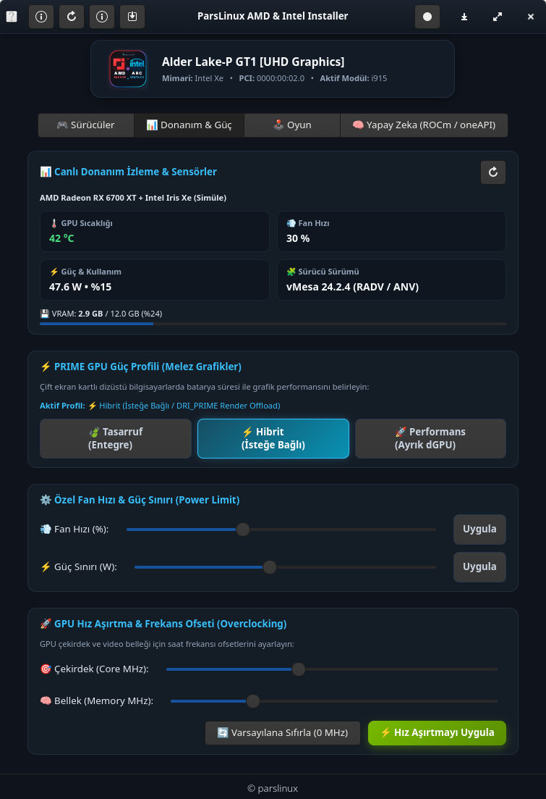
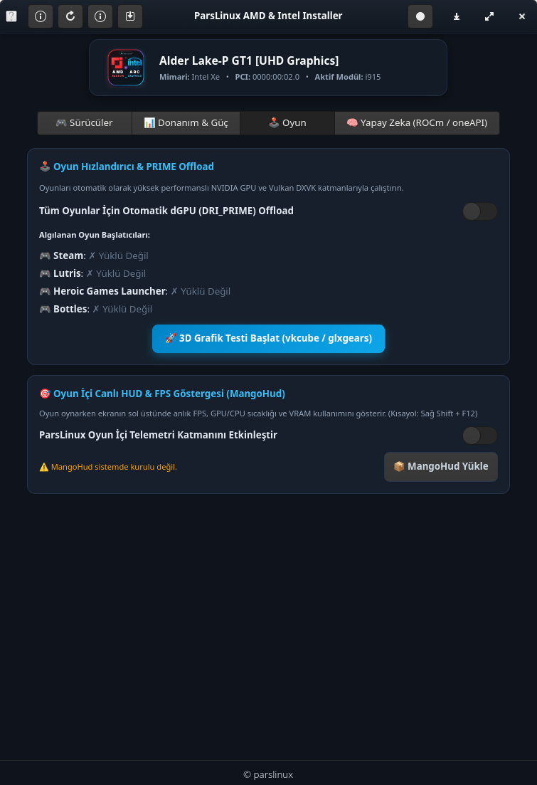
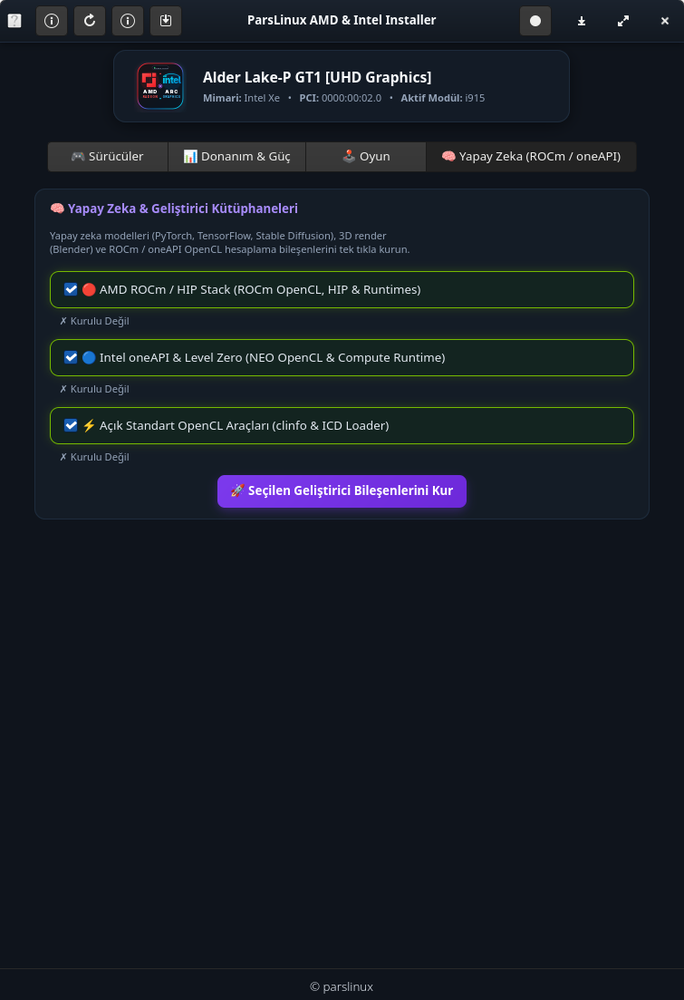

# 🎮 ParsLinux AMD & Intel Installer

[](LICENSE)
[](https://parslinux.org)
[](https://www.python.org/)
[](https://www.gtk.org/)
[](docs/VERSION.md)

**ParsLinux AMD & Intel Installer**, ParsLinux işletim sisteminde AMD Radeon ve Intel (Iris Xe, UHD, Arc) ekran kartları ve entegre grafik işlemcileri için Vulkan katmanlarını, donanım video hızlandırma kütüphanelerini (VA-API/QuickSync), 32-bit oyun paketlerini, hesaplama/AI çalışma ortamlarını (ROCm/oneAPI) ve canlı donanım telemetrisini yöneten modern bir grafiksel sistem merkezidir.

Hem saf tekil GPU sistemlerini hem de çift grafik kartlı melez dizüstü bilgisayarları (Intel CPU + AMD GPU veya AMD APU + Intel Arc) otomatik olarak tanır ve en uygun optimizasyonları sunar.

---

## 🚀 Temel Özellikler

- 🔍 **Akıllı Donanım Tespiti:** Sistemdeki PCI veriyolunu tarayarak AMD ve Intel grafik donanımlarını (Dahili iGPU / Harici dGPU rollerini) otomatik olarak algılar.
- 🎯 **Vulkan & Grafik Katmanları:** AMD için RADV (`vulkan-radeon`) ve AMDVLK; Intel için ANV (`vulkan-intel`) ve Xe sürücüleri ile 32-bit multilib oyun kütüphanelerini tek tıkla kurup yapılandırır.
- 🎬 **Donanım Video Hızlandırma (VA-API & QuickSync):** Web tarayıcılarında (Firefox, Chromium) ve medya oynatıcılarda 4K/8K videoların GPU üzerinden akıcı çözülmesi için `mesa-va-drivers`, `intel-media-driver` entegrasyonu.
- 📊 **Canlı Donanım İzleme & Sensörler:** Gerçek zamanlı GPU sıcaklığı, fan hızı, VRAM bellek kullanımı ve güç tüketimi (`Watt`) takibi.
- ⚡ **PRIME & Melez Güç Yönetimi:** Dizüstü bilgisayarlarda pil tasarrufu modu ile harici kartı uyutma veya oyunlarda yüksek performanslı GPU offload (`DRI_PRIME=1`) geçişi.
- 🧠 **Yapay Zeka & Hesaplama (Compute / AI):** 
  - **AMD:** ROCm Toolkit, OpenCL (`rocm-opencl-runtime` / `rusticl`), HIP ve PyTorch desteği.
  - **Intel:** Intel oneAPI, Intel Compute Runtime (NEO OpenCL), Level Zero ve OpenVINO desteği.
- 🕹️ **Oyun Hızlandırıcı & MangoHud:** Steam, Lutris, Heroic ve Bottles oyunlarında ekran üzeri canlı FPS, sıcaklık ve gecikme HUD katmanı (`MangoHud`).
- 🖥️ **Sistem Tepsisi (AppIndicator / Tray):** Masaüstü üst barında canlı sıcaklık ve aktif kart göstergesi ile hızlı menü erişimi.
- 🖥️ **Entegre VTE Terminali:** Yapılan tüm paket ve yapılandırma işlemlerini gerçek zamanlı terminal günlüğüyle takip etme imkanı.
- 🧪 **Geliştirici & Sanal Makine Simülasyonu:** AMD/Intel kartı bulunmayan ortamlarda dahi `--debug` moduyla tam arayüz testi.
- 📦 **Çift Paketleme Desteği:** Hem Debian tabanlı sistemler için `.deb` hem de Arch Linux / CachyOS için `.pkg.tar.zst` paketleme desteği.

---

## 📸 Ekran Görüntüleri

| 🎮 Sürücüler & Grafik Katmanları | 📊 Donanım & Güç İzleme |
| :---: | :---: |
|  |  |

| 🕹️ Oyun & PRIME Performans | 🧠 Yapay Zeka (ROCm / oneAPI) |
| :---: | :---: |
|  |  |

---

## 🛠️ Sistem Gereksinimleri

| Bileşen | Paket Adı (Debian / ParsLinux) | Paket Adı (Arch Linux / CachyOS) |
|---|---|---|
| **Python** | `python3` (3.8+) | `python` |
| **GObject Introspection** | `python3-gi`, `gir1.2-gtk-4.0` | `python-gobject`, `gtk4` |
| **Terminal Bileşeni** | `gir1.2-vte-2.91` | `vte3` |
| **Sistem Tepsisi** | `gir1.2-ayatanaappindicator3-0.1` | `libayatana-appindicator` |
| **Yetkilendirme (Polkit)** | `gir1.2-polkit-1.0`, `policykit-1` | `polkit` |
| **Donanım Tanıma** | `pciutils`, `hwdata` | `pciutils`, `hwdata` |

---

## 💻 Kullanım ve Hızlı Başlangıç

### Geliştirici / Yerel Çalıştırma
```bash
# Donanım tespiti yaparak başlatma
./run.sh

# Simülasyon modunda başlatma (Test için)
./run.sh --debug

# Sistem tepsisi göstergesini başlatma
./parslinux-amd-intel-installer --tray

# Donanım tespitini terminale yazdırma
./parslinux-amd-intel-installer --detect --json

# Master kontrol paneli
./manage.sh
```

### Sistem Kurulumu
```bash
# Otomatik bağımlılık kontrolü ve sisteme kurulum
./install.sh

# Sistemden temiz kaldırma
./uninstall.sh
```

### Paket Derleme (.deb ve .pkg.tar.zst)
```bash
# Otomatik tespit ve derleme
./package.sh

# Sadece Debian paketi (.deb) derleme
./package.sh --deb

# Sadece Arch paketi (.pkg.tar.zst) derleme
./package.sh --arch
```

### Testleri Çalıştırma
```bash
python3 -m unittest discover -s tests -p "test_*.py" -v
# veya
./manage.sh test
```

---

## 📁 Proje Dizin Yapısı

```
parslinux-amd-intel-installer/
├── parslinux-amd-intel-installer # Ana ikili başlatıcı (CLI / GUI)
├── org.parslinux.amd-intel-installer.desktop # XDG masaüstü kısayolu
├── org.parslinux.pkexec.parslinux-amd-intel-installer.policy # Polkit güvenlik politikası
├── setup.py                        # Python kurulum betiği
├── meson.build                     # Meson derleme tanımı
├── PKGBUILD / .SRCINFO             # Arch Linux / CachyOS paket tanımları
├── debian/                         # Debian paketleme ve betikleri
├── docs/                           # Kapsamlı standart dokümantasyon seti
├── src/
│   ├── Main.py                     # Gtk.Application giriş noktası ve CLI ayrıştırıcı
│   ├── MainWindow.py               # Modern sekmeli ana pencere denetleyicisi
│   ├── detector.py                 # PCI, sysfs ve donanım algılama motoru
│   ├── monitor.py                  # Canlı GPU sensörleri, telemetri ve fan/güç takibi
│   ├── tray.py                     # Sistem tepsisi (AppIndicator) durum göstergesi
│   └── package.py                  # PolicyKit root yetkili paket yöneticisi
└── tests/                          # Birim test takımı
```

---

## 🤝 Katkıda Bulunma ve Lisans

Katkıda bulunma yönergeleri için [docs/CONTRIBUTING.md](docs/CONTRIBUTING.md) belgesini inceleyebilirsiniz.
Bu proje **GNU General Public License v3.0 (GPL-3.0-or-later)** ile lisanslanmıştır.
Tüm hakları ParsLinux Topluluğu ve katkıcılarına aittir.
